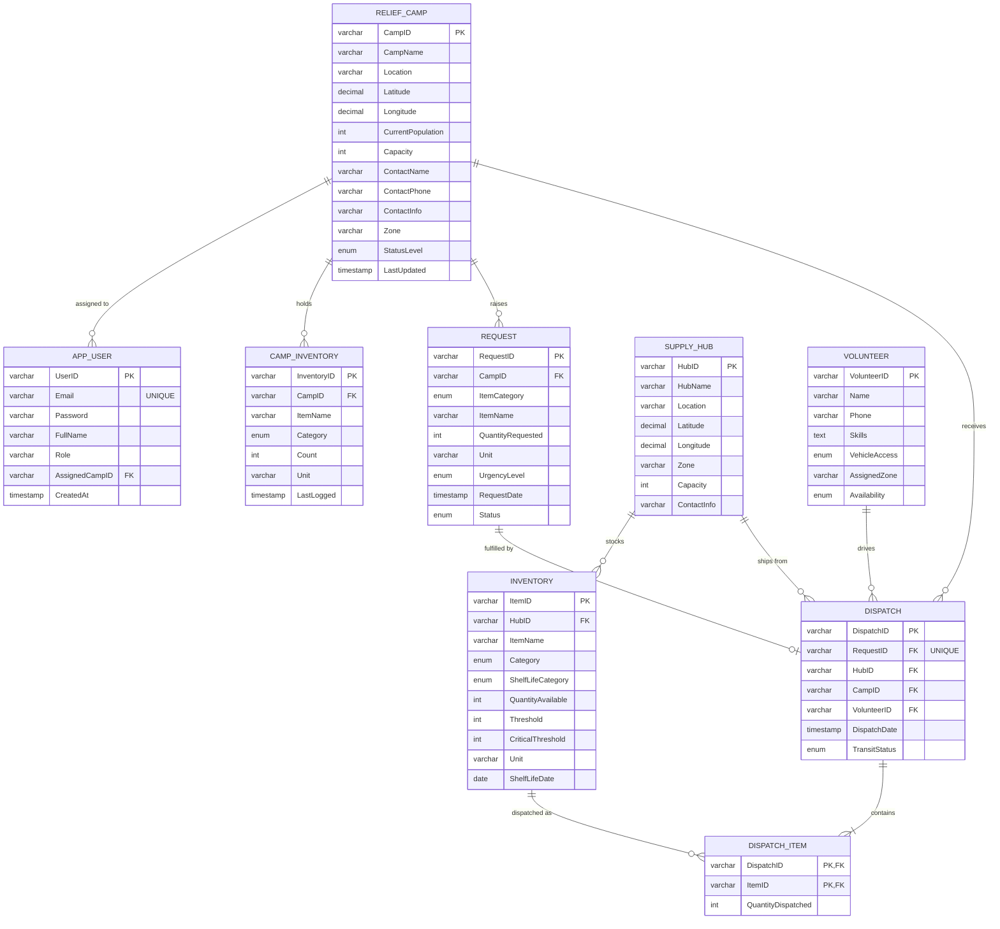

# ER Diagram - Disaster Relief & Resource Distribution

Derived from `database/schema.sql` (SQLite) / `schema_mysql.sql` / `postgresql/schema.sql`.
GitHub renders the diagram below automatically.

## Notes
- `DISPATCH_ITEM` is the associative (bridge) table between `DISPATCH` and `INVENTORY`: composite PK (`DispatchID`, `ItemID`).
- `DISPATCH.RequestID` is UNIQUE, so a request has at most one dispatch (1 : 0..1).
- `CAMP_INVENTORY` has UNIQUE (`CampID`, `ItemName`).
- `StatusLevel` is maintained by triggers on `CAMP_INVENTORY`: Critical when water < 2 x population or food < 0.5 x population.
- `trg_prevent_volunteer_double_booking` blocks dispatching a volunteer who is already assigned (API returns 409).
